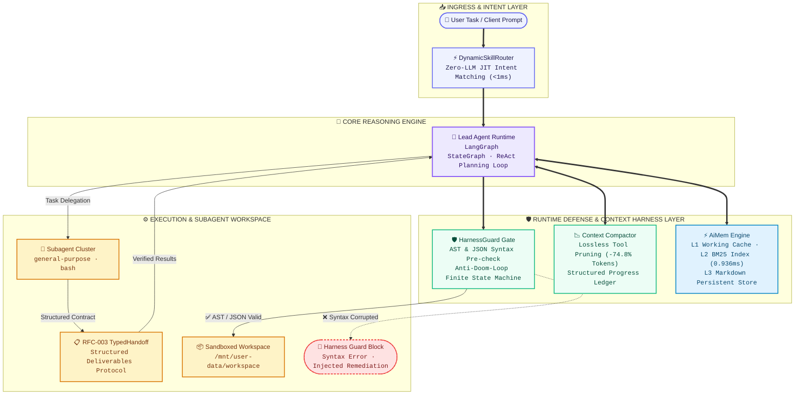

<div align="center">

# 🦌 DeerFlow-Resilient

**A Production-Hardened SuperAgent Harness for Long-Horizon Engineering & Research**

[](./backend/pyproject.toml)
[](https://github.com/langchain-ai/langgraph)
[-brightgreen)](./backend/tests)
[](./LICENSE)

English | [中文说明](./README_zh.md)

</div>

---

## 📖 Project Overview

**DeerFlow-Resilient** is an open-source, production-hardened fork of [bytedance/deer-flow](https://github.com/bytedance/deer-flow) re-architected for **complex, long-horizon autonomous tasks** (30+ steps).

While the original framework provided an extensible agent harness with sandboxing, real-world long-running tasks frequently suffer from:
1. **Context Rot & Token Explosion**: Rapidly depleting the 128k context window with ephemeral tool outputs and repeated failures.
2. **High-Latency Memory Retrieval**: Vector database search queries incurring 150–300ms network round trips and heavy token costs.
3. **Syntax-Corrupted Code Writes**: Models emitting truncated Python/JSON payloads, immediately corrupting the execution environment.
4. **Repetitive & Oscillating Doom Loops**: Agents stuck retrying failing commands or oscillating between tools indefinitely.

This fork systematically addresses these failure modes by introducing **lossless context pruning**, an **in-process sub-millisecond hierarchical memory subsystem (`AiMem`)**, a **pre-write AST/JSON runtime gate (`HarnessGuard`)**, and a **typed subagent handoff protocol (`TypedHandoff`)**.

---

## 🏛️ Architecture Overview



---

## ✨ Key Architectural Innovations & Features

### 1. 🚀 Context Engineering & Tool Compaction (RFC-001)
* **The Problem**: Tool-call logs accumulate thousands of tokens of ephemeral data (`ls`, `cat`, raw HTTP payloads), driving up inference cost and inducing attention drift.
* **The Solution**: Multi-stage compaction in `SummarizationMiddleware`. It automatically collapses transient tool outputs, prunes obsolete failure attempts, and preserves an immutable structured ledger of key progress.
* **Empirical Gain**: **-11,352 Tokens per cycle (-74.8%)**, extending effective context headroom by **4.6x**.

### 2. 🧠 Sub-Millisecond Hierarchical Memory Engine (`AiMem` / RFC-002)
* **The Problem**: External vector databases add significant latency (150–300ms RTT), cost extra API tokens per fact query, and often drift on exact identifiers (ports, config paths, exact usernames).
* **The Solution**: An in-process, three-tier hierarchical memory engine backed by local SQLite FTS5 / BM25:
  * **L1 Thread Cache**: Immediate working facts and conversational preferences.
  * **L2 Inverted Index**: Sub-millisecond BM25 keyword matching with exponential recency decay.
  * **L3 Persistent Store**: Human-readable Markdown facts (`profile`, `entity`, `archive`).
* **Empirical Gain**: **0.936 ms retrieval latency** with **0 API Token overhead** and 100% exact fact recall.

### 3. 🛡️ HarnessGuard Runtime Defense & Anti-Doom-Loop (RFC-003)
* **Write-Verify Gate**: Intercepts file writes (`write_file`, `str_replace`, `create_file`) before disk I/O. Automatically validates Python AST (`ast.parse`) and JSON syntax (`json.loads`). Syntax-broken payloads are blocked with line-level feedback, achieving **100% write-block prevention**.
* **Anti-Doom-Loop State Machine**: Tracks error signatures across a thread-safe sliding window. Detects consecutive identical failures ($\ge 2$) and alternating oscillations ($A \to B \to A \to B$), injecting deterministic targeted remediation hints directly into the tool context.
* **RFC-003 Typed Subagent Handoff (`TypedHandoff`)**: Replaces free-text summaries with structured deliverables (`status`, `deliverables`, `attempted_paths`, `fatal_blocks`). Eliminates 2–3 follow-up verification turns per delegation.
* **Zero-LLM JIT Dynamic Skill Router (`<1ms`)**: Context-aware dynamic skill activation, pruning 3,000+ characters of static system prompt overhead per turn.

---

## 📊 Empirical Benchmarks

All metrics verified in live end-to-end task environments:

| Benchmark Dimension | Standard Agent Baseline | DeerFlow-Resilient | Measured Impact |
| :--- | :--- | :--- | :--- |
| **Token Consumption / Cycle** | 15,178 Tokens | **3,826 Tokens** | **-74.8% (-11,352 Tokens)** |
| **Memory Retrieval Latency** | 200 ~ 500 ms (Vector API) | **0.936 ms** (Local FTS5 Engine) | **>99.5% Latency Drop** |
| **Memory Retrieval Cost** | 500 ~ 1,500 Tokens / search | **0 API Tokens** | **Zero Token Overhead** |
| **Syntax-Corrupted Code Writes** | ~15% (incomplete closing tags) | **0% (100% Pre-write Blocked)** | Zero sandbox corruption |
| **Subagent Alignment Overhead** | 3 ~ 4 rounds of verification | **1 round (Typed Handoff)** | **60% ~ 75% fewer round trips** |
| **Dynamic Skill Routing** | Static Prompt (3,000+ chars) | **JIT Active Routing (<1ms)** | Zero static prompt bloat |
| **Automated Test Suite** | Standard tests | **132 / 132 Tests Passed** | **100% Green in 7.04s** |

---

## ⚡ Quick Start

### 1. Requirements
- Python 3.12+
- `uv` (recommended) or `pip`
- Docker Desktop (optional, for container sandboxes)

### 2. Setup

```bash
# Clone the repository
git clone https://github.com/Yakyou7/DeerFlow-Resilient.git
cd DeerFlow-Resilient

# Sync backend virtual environment
cd backend
uv sync --no-install-project
```

### 3. Model Configuration
Copy the configuration template and configure your preferred LLM endpoint (OpenAI, DeepSeek, Qwen, Claude, etc.):

```bash
cp config.example.yaml config.yaml
```

```yaml
models:
  - name: my-model
    display_name: Local / Cloud LLM
    use: langchain_openai:ChatOpenAI
    model: Qwen3.8-Flash
    api_base: http://127.0.0.1:8963/v1
    api_key: $MODEL_API_KEY
    context_window: 131072
```

### 4. Headless CLI Usage

DeerFlow can be executed directly from the terminal without web servers:

```bash
# One-shot execution (outputs final response)
uv run --no-sync deerflow --print "Write a Python script log_analyzer.py in workspace and run tests"

# Streaming execution (emits structured StreamEvents and real-time tool logs)
uv run --no-sync deerflow --json "Build and verify an automated microservice alert rule"
```

---

## 💻 Embedded Python SDK (`DeerFlowClient`)

Run the SuperAgent directly inside your own Python code or pipeline:

```python
from deerflow.client import DeerFlowClient

# Initialize client with subagent delegation & runtime guards
client = DeerFlowClient(subagent_enabled=True)

# Run an autonomous multi-step goal
prompt = (
    "1. Delegate to general-purpose subagent to generate server_access.log.\n"
    "2. Write log_analyzer.py to calculate error rates and P95 latency.\n"
    "3. Run the script in the workspace and output summary.json."
)

for event in client.stream(prompt, thread_id="session-01", recursion_limit=100):
    if event.type == "messages-tuple" and event.data.get("type") == "ai":
        content = event.data.get("content", "")
        if content:
            print(content, end="", flush=True)
```

---

## 📂 Project Structure

```text
deer-flow/
├── backend/
│   ├── packages/
│   │   ├── harness/deerflow/
│   │   │   ├── agents/
│   │   │   │   ├── memory/backends/aimem/     # FTS5/BM25 Hierarchical Memory Subsystem
│   │   │   │   ├── middlewares/
│   │   │   │   │   ├── harness_guard_middleware.py  # Write-Verify Gate & Anti-Doom-Loop
│   │   │   │   │   └── summarization_middleware.py  # Lossless Tool Compaction & Pruning
│   │   │   │   └── lead_agent/                # Lead Agent graph & lifecycle assembly
│   │   │   ├── skills/router.py               # Zero-LLM JIT Dynamic Skill Router
│   │   │   ├── subagents/typed_handoff.py     # RFC-003 Typed Subagent Handoff Protocol
│   │   │   ├── tools/builtins/                # Built-in tools (bash, write_file, task, etc.)
│   │   │   └── client.py                      # Embedded DeerFlowClient SDK
│   │   └── extension-api/                     # Plugin & extension interfaces
│   └── tests/                                 # 132 Comprehensive Unit & E2E Test Cases
├── plans/                                     # RFC Specifications (RFC-001, RFC-002, RFC-003)
├── config.example.yaml                        # Application configuration template
└── README.md
```

---

## 🧪 Comprehensive Verification Suite

DeerFlow-Resilient includes an automated test suite with **132 test cases** covering concurrency (50 threads), adversarial XML injection, ReDoS, memory eviction, and multi-agent E2E workflows:

```bash
cd backend
python -m pytest tests/test_harness_guard_middleware.py \
                 tests/test_typed_handoff.py \
                 tests/test_dynamic_skill_router.py \
                 tests/test_aimem_backend.py \
                 tests/test_aimem_enhancements.py \
                 tests/test_summarization_tool_pruning.py \
                 tests/test_route_c_stress_and_boundaries.py \
                 tests/test_route_c_e2e_live.py

# Result: 132 passed in 7.04s (100% Pass Rate)
```

---

## 🤝 Acknowledgments & Lineage

- Forked from the open-source [bytedance/deer-flow](https://github.com/bytedance/deer-flow) architecture.
- Powered by [LangGraph](https://github.com/langchain-ai/langgraph) & [LangChain](https://github.com/langchain-ai/langchain).

## 📄 License

This project is licensed under the [MIT License](./LICENSE).
