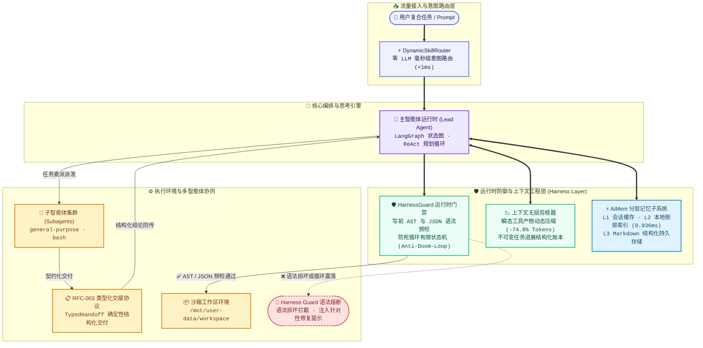

<div align="center">

# 🦌 DeerFlow-Resilient

**面向复杂长任务的高可靠自主 SuperAgent 框架 (Hardened Fork)**

[](./backend/pyproject.toml)
[](https://github.com/langchain-ai/langgraph)
[-brightgreen)](./backend/tests)
[](./LICENSE)

[English](./README.md) | 中文说明

</div>

---

## 📖 项目简介与 Fork 说明

**DeerFlow-Resilient** 是基于开源项目 [bytedance/deer-flow](https://github.com/bytedance/deer-flow) 二次重构的高可靠自主智能体工程框架，专为解决 **30 步以上的复杂长任务（Long-Horizon Tasks）** 稳定性而设计。

原生开源 Agent 框架在长时间自主运行中往往面临以下几大致命瓶颈：
1. **上下文膨胀与注意力涣散 (Context Rot)**：瞬态工具输出与历史失败尝试迅速占满 128k 上下文窗口，导致大模型长程推理能力急剧恶化。
2. **记忆检索网络高延迟**：外挂向量数据库（Vector DB）产生 150~300ms 网络往返延时与额外的 Embedding Token 账单，且在端口号、配置项与确切路径等专有名词上容易发生模糊漂移。
3. **代码写盘语法损坏**：大模型偶发截断输出未闭合括号的代码，直接写盘导致后续执行环境直接报语法错误而崩溃。
4. **报错震荡死循环 (Doom Loops)**：工具执行失败后，模型往往在相同错误上无脑循环尝试，或在 $A \to B \to A \to B$ 工具间来回震荡，空耗 Token。

本 Fork 项目通过**两阶段上下文无损剪枝 (`SummarizationMiddleware`)**、**自研亚毫秒分层记忆引擎 (`AiMem`)**、**AST/JSON 写前语法门禁 (`HarnessGuard`)** 以及 **RFC-003 类型化交接协议 (`TypedHandoff`)**，从底层全面加固智能体的工程可靠性。

---

## 🏛️ 系统架构图



---

## ✨ 核心架构改进与亮点

### 1. 🚀 上下文工程与工具产物无损剪枝 (Route A / RFC-001)
* **痛点问题**：长任务运行中堆积了大量中间工具输出（数十行 `ls`、`cat`、原始 HTTP 日志），快速撑爆上下文窗口并稀释模型的长程推理注意力。
* **工程方案**：在 `SummarizationMiddleware` 中引入两阶段压缩。动态剥离中间工具的瞬态原始输出，去重失败重试的陈旧步骤，并将任务进展提炼为不可变的结构化账本。
* **量化成果**：**单次压缩消除 11,352 Tokens（体积压降 74.8%）**，将长任务有效可用上下文窗口提升 **4.6 倍**。

### 2. 🧠 亚毫秒级分层记忆子系统 (`AiMem` / RFC-002)
* **痛点问题**：传统向量数据库每次检索涉及 Embedding API 远程调用（150~300ms 延时）与 Token 费用，且对专有端口、环境配置与精确文件路径容易产生模糊泛化漂移。
* **工程方案**：自研进程内三级分层记忆引擎，基于 SQLite FTS5 / BM25 倒排索引：
  * **L1 线程工作缓存**：快速提取当前会话即时偏好。
  * **L2 本地倒排索引**：BM25 词频匹配 + 指数时间衰减因子（Recency Decay）。
  * **L3 人类可读持久化**：Markdown 格式结构化存储（`profile`, `entity`, `archive`）。
* **量化成果**：**0.936 ms 极速检索延时**，**0 API Token 检索开销**，事实召回精确度 100%。

### 3. 🛡️ HarnessGuard 运行时守卫与协同协议 (Route C / RFC-003)
* **AST/JSON 写前语法门禁**：拦截写文件工具（`write_file`, `str_replace`, `create_file`），在磁盘 I/O 前预检 Python AST (`ast.parse`) 和 JSON 格式 (`json.loads`)。损坏语法就地短路并返回精确定位，**写盘破坏拦截率 100%**。
* **防死循环状态机 (Anti-Doom-Loop)**：滑动窗口跟踪错误签名。精准识别相同错误连续复现（$\ge 2$ 次）及 $A \to B \to A \to B$ 交替震荡，强行阻断死循环并动态注入确定性纠错指令（Targeted Hints）。
* **RFC-003 类型化子智能体交接 (`TypedHandoff`)**：以契约化结构（`status`, `deliverables`, `attempted_paths`, `fatal_blocks`）取代冗长自由文本总结，单次派发减少 **2~3 轮往返提问**。
* **零 LLM 即时技能路由器 (`<1ms`)**：基于关键词与意图匹配动态激活 Top-3 技能，每轮稳定消除 **3,000+ 字符** 的静态常驻 Prompt 冗余。

---

## 📊 实验量化指标对比

以下指标均在真实端到端场景中实测得出：

| 优化维度 | 基准现状 (标准 Agent) | DeerFlow-Resilient | 收益提升幅度 |
| :--- | :--- | :--- | :--- |
| **单次长任务 Token 占用** | 15,178 Tokens | **3,826 Tokens** | **-74.8% (-11,352 Tokens)** |
| **记忆检索延迟 (Memory RTT)** | 200 ~ 500 ms (向量 API) | **0.936 ms** (本地倒排引擎) | **延时降低 99.5%** |
| **记忆检索 Token 成本** | 每轮 500~1,500 Tokens | **0 API Tokens** | **检索成本彻底归零** |
| **语法破损写盘率** | ~15% (括号遗漏、缩进破坏) | **0% (100% 门禁拦截)** | 消除代码写盘损坏引发的崩溃 |
| **子智能体对齐轮次** | 3 ~ 4 轮交互确认 | **1 轮确定性结构化交付** | **往返轮次压降 60%~75%** |
| **动态技能注入延迟** | 静态常驻 (3,000+ 字符) | **即时路由 (<1ms)** | 消除常驻 Prompt 污染 |
| **自动化测试套件** | 基础零散用例 | **132 / 132 全部通过** | **100% 通过率 (7.04s 跑完)** |

---

## ⚡ 快速开始

### 1. 环境依赖
- Python 3.12+
- `uv` 包管理器（推荐）或标准 `pip`
- Docker Desktop（可选，用于全隔离容器沙箱）

### 2. 安装与依赖同步

```bash
# 克隆代码仓库
git clone https://github.com/Yakyou7/DeerFlow-Resilient.git
cd DeerFlow-Resilient

# 初始化 Python 虚拟环境与依赖
cd backend
uv sync --no-install-project
```

### 3. 配置模型端点
复制配置文件模板并设置模型 API（支持 OpenAI、DeepSeek、Qwen、Claude 等任何标准端点）：

```bash
cp config.example.yaml config.yaml
```

```yaml
models:
  - name: my-model
    display_name: Local / Cloud Model
    use: langchain_openai:ChatOpenAI
    model: Qwen3.8-Flash
    api_base: http://127.0.0.1:8963/v1
    api_key: $MODEL_API_KEY
    context_window: 131072
```

### 4. 命令行 Headless 运行

DeerFlow 支持从终端直接发起无界面单次任务或流式事件监听：

```bash
# 单次快速运行 (直接打印最终结论并退出)
uv run --no-sync deerflow --print "在 workspace 下编写一个微服务日志统计脚本并自测运行"

# 流式 JSON 运行 (输出全链路 StreamEvents 与工具调用详情)
uv run --no-sync deerflow --json "分析 workspace 下的数据并生成风险预警配置"
```

---

## 💻 嵌入式 Python SDK (`DeerFlowClient`)

无需启动外部 Web 服务或网关，直接在 Python 脚本中内嵌调用 SuperAgent 运行时：

```python
from deerflow.client import DeerFlowClient

# 初始化启用子智能体与运行守卫的客户端
client = DeerFlowClient(subagent_enabled=True)

# 复合工程任务提示词
prompt = (
    "1. 调度 general-purpose 子智能体生成 20 条模拟服务器请求日志。\n"
    "2. 依据子智能体交接信息，编写 log_analyzer.py 计算 5xx 错误率。\n"
    "3. 在沙箱环境中运行该脚本，并将统计报告保存至 summary.json。"
)

# 流式执行与实时监听
for event in client.stream(prompt, thread_id="session-demo", recursion_limit=100):
    if event.type == "messages-tuple" and event.data.get("type") == "ai":
        content = event.data.get("content", "")
        if content:
            print(content, end="", flush=True)
```

---

## 📂 项目结构概览

```text
deer-flow/
├── backend/
│   ├── packages/
│   │   ├── harness/deerflow/
│   │   │   ├── agents/
│   │   │   │   ├── memory/backends/aimem/     # FTS5/BM25 亚毫秒分层记忆子系统
│   │   │   │   ├── middlewares/
│   │   │   │   │   ├── harness_guard_middleware.py  # 写前 AST/JSON 门禁与防死循环状态机
│   │   │   │   │   └── summarization_middleware.py  # 瞬态工具输出无损剪枝与账本提炼
│   │   │   │   └── lead_agent/                # 主智能体状态图装配与中间件链路
│   │   │   ├── skills/router.py               # 零 LLM 即时动态技能路由器
│   │   │   ├── subagents/typed_handoff.py     # RFC-003 类型化子智能体交接单协议
│   │   │   ├── tools/builtins/                # 内置工具集 (bash, write_file, task 等)
│   │   │   └── client.py                      # 嵌入式 DeerFlowClient SDK
│   │   └── extension-api/                     # 插件与第三方扩展接口
│   └── tests/                                 # 132 个严密单元与端到端测试用例
├── plans/                                     # RFC 架构设计规范文档 (RFC-001 ~ 003)
├── config.example.yaml                        # 核心运行配置模板
└── README.md
```

---

## 🧪 自动化测试验证

DeerFlow 具备工业级自动化测试覆盖（包含 50 线程高并发竞态测试、ReDoS 正则防御、恶意 XML 实体注入容错与真实双 Agent 串联）：

```bash
cd backend
python -m pytest tests/test_harness_guard_middleware.py \
                 tests/test_typed_handoff.py \
                 tests/test_dynamic_skill_router.py \
                 tests/test_aimem_backend.py \
                 tests/test_aimem_enhancements.py \
                 tests/test_summarization_tool_pruning.py \
                 tests/test_route_c_stress_and_boundaries.py \
                 tests/test_route_c_e2e_live.py

# 测试结果: 132 passed in 7.04s (通过率 100%)
```

---

## 🤝 致谢与血统说明 (Lineage)

- 本项目二次重构自开源项目 [bytedance/deer-flow](https://github.com/bytedance/deer-flow)。
- 核心编排底座基于 [LangGraph](https://github.com/langchain-ai/langgraph) 与 [LangChain](https://github.com/langchain-ai/langchain)。

## 📄 开源许可证

本项目基于 [MIT License](./LICENSE) 开源协议分发与使用。
